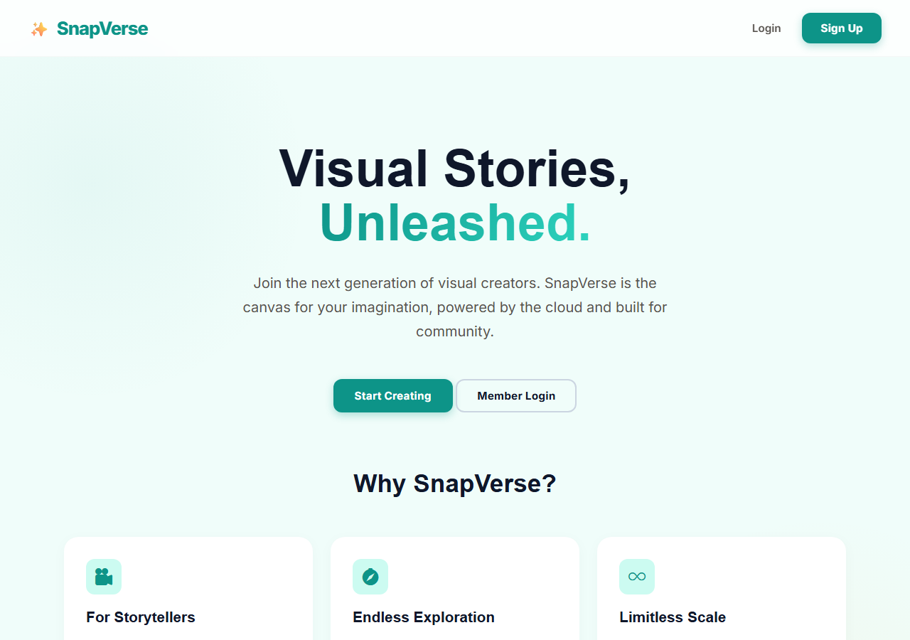
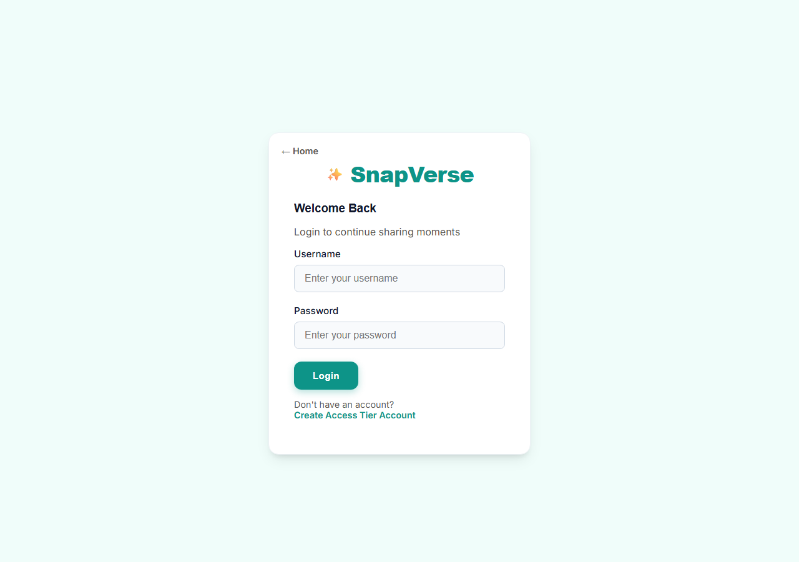
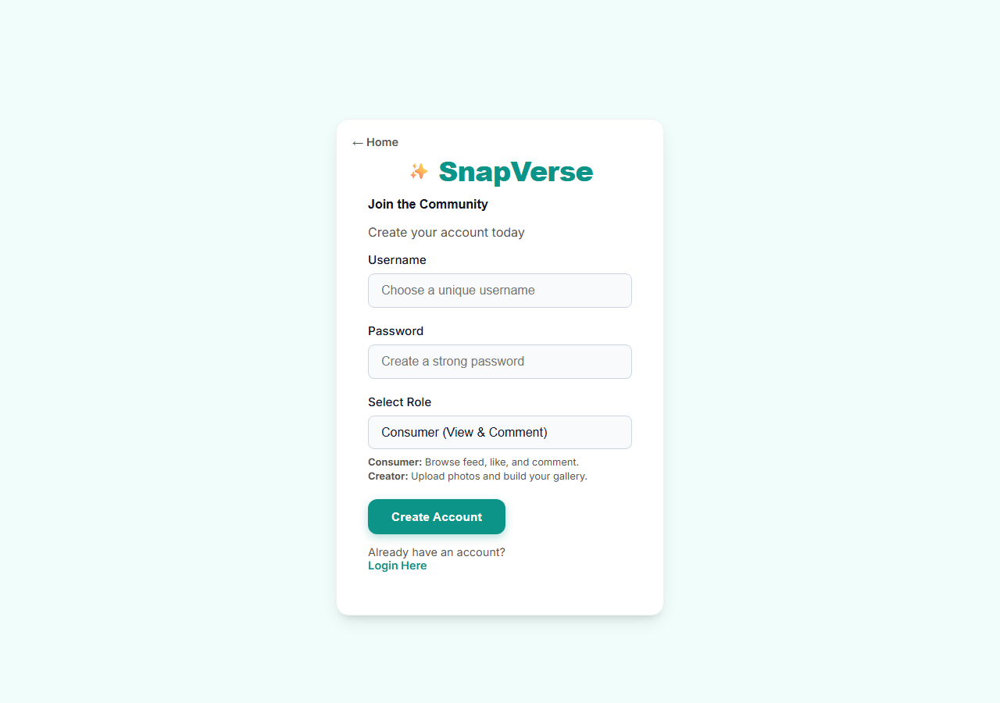
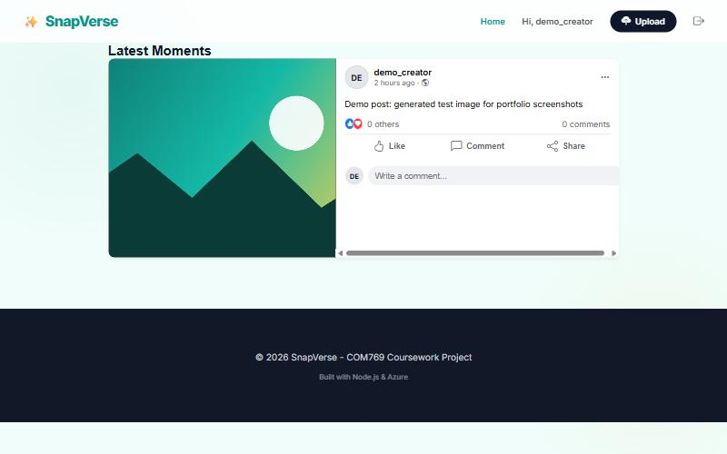
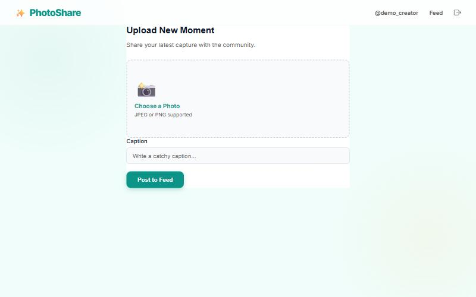

# SnapVerse: Photo-Sharing Web App on Microsoft Azure

> 🎓 **MSc project, Ulster University** (Cloud Computing / Scalable systems coursework, Computer Science & Technology).
> A learning project: user data is held in memory and the app is **not production-ready** (see limitations).

> ☁️ **Deployment note:** the app was deployed to Azure App Service (free F1 plan) with a GitHub Actions pipeline during my MSc module. I no longer keep a public demo linked, so see the screenshots below, or run it locally / with Docker.

## What it does
SnapVerse is a small Instagram-style web app where users sign up, log in and share photos. It was built to practise designing, containerising and deploying a web application on Microsoft Azure.

## Features
- **Sign up / log in / log out** with server-side sessions (`express-session`)
- **Role-based access:** `creator` accounts can upload photos, `consumer` accounts can only browse, like and comment
- **Photo upload** with captions (Multer), stored in **Azure Blob Storage**
- **Feed** with likes and comments
- Server-rendered pages with **EJS** templates

## Tech stack
Node.js · Express · EJS · express-session · Multer · Azure Blob Storage SDK · Docker · GitHub Actions · Azure App Service · Kubernetes manifest (Azure Container Registry image)

## Azure and DevOps
| Piece | Where |
|-------|-------|
| Container image | [`Dockerfile`](Dockerfile) (Node 18) |
| CI/CD to Azure App Service | [`docs/azure-appservice-deploy.workflow.yml`](docs/azure-appservice-deploy.workflow.yml): build, then deploy on push to `main`, with Azure login via OIDC and **repository secrets** (no credentials in code). Kept in `docs/` so it does not run on this copy; move it to `.github/workflows/` and add your own secrets to use it |
| Kubernetes deployment (2 replicas) | [`k8s/deployment.yaml`](k8s/deployment.yaml): replace `<your-registry>` with your own Azure Container Registry |

## Run it locally
```bash
git clone https://github.com/Yawar-hussain/snapverse-azure-web-app.git
cd snapverse-azure-web-app
npm install
cp .env.example .env     # set SESSION_SECRET and AZURE_STORAGE_CONNECTION_STRING (your own storage account)
node server.js           # http://localhost:3000
```
Or with Docker:
```bash
docker build -t snapverse .
docker run -p 3000:3000 -e SESSION_SECRET=change-me -e AZURE_STORAGE_CONNECTION_STRING="<yours>" snapverse
```

## Screenshots
| Landing page | Login | Sign up |
|---|---|---|
|  |  |  |

| Feed (image served from Azure Blob Storage) | Upload page (creator role) |
|---|---|
|  |  |

## Limitations (what this project is not)
- **Users, captions, likes and comments are stored in memory**, so they are lost when the app restarts (only the photos persist, in Blob Storage)
- **Passwords are stored in plain text in memory.** This is acceptable for a coursework demo only
- The photo container is public-read, and there is no image validation or size limit

## What I would do differently in production
- Hash passwords (bcrypt) and store users and posts in a managed database (Azure Cosmos DB or Azure SQL)
- Serve images through a CDN and generate short-lived (SAS) URLs instead of a public container
- Use Azure Key Vault for secrets, HTTPS only, CSRF protection and rate limiting
- Add automated tests and health-check endpoints, and autoscale on Azure App Service or AKS

---
*No credentials are stored in this repository. Configuration is read from environment variables, and the `.env` file is git-ignored.*
